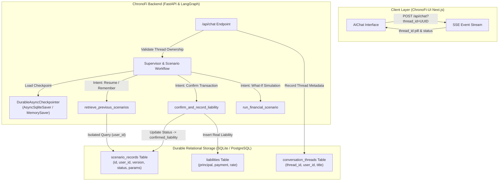

# Persistent Memory for AI Life Financial Planner Using LangGraph Checkpointers

## Architecture Overview

ChronoFi's AI Life Financial Planner implements a dual-layer persistence and memory architecture to enable seamless resumption of financial advisory discussions, accurate retrieval of historical scenario simulations, and safe confirmation of real financial liabilities.

---

## 1. Dual-Layer Persistence

### A. Conversation-State Persistence (LangGraph Checkpointers)
* **Checkpointer implementation**: `core/checkpointer.py` defines `DurableAsyncCheckpointer`, an async wrapper supporting `AsyncSqliteSaver` (persisting to `chronofi_checkpoints.db`) with fallback to `MemorySaver` for testing environments.
* **Auto Thread Recovery**: Implements `_ensure_thread_id` so graph invocations without an explicit thread ID generate a fallback thread instead of failing with `KeyError: 'thread_id'`.
* **State Preservation**: Persists `messages`, `thread_id`, `user_id`, `active_scenario_id`, `retrieved_memory_refs`, `pending_confirmation`, and `simulation_result`.
* **Process Restart Continuity**: Graph state survives backend process restarts when configured with `AsyncSqliteSaver`.

### B. Durable Relational Storage (Database Entities)
* **`conversation_threads`**: Tracks user thread ownership (`thread_id`, `user_id`, `title`, timestamps) to enforce strict user authorization and prevent cross-user conversation leakage.
* **`scenario_records`**: Stores complete simulation runs with:
  * `version`: Integer tracking scenario lineage (`version = parent.version + 1`).
  * `parent_scenario_id`: Foreign key pointer to the scenario version it branched from.
  * `status`: State lifecycle: `'simulated'`, `'confirmed_liability'`, or `'archived'`.
  * `parameters` & `assumptions`: Full JSON records of user-provided and explicitly defaulted inputs.
  * `results_summary`: Cached impact on retirement corpus, target delay, and monthly cash flow.
* **`liabilities`**: Official financial ledger storing actual, confirmed commitments.

---

## 2. Intent vs. Confirmation Guardrail

A fundamental fintech security guardrail is enforcing the difference between:
1. **Hypothetical discussion**: Exploring what might happen.
2. **Decision / Intention**: Saying *"I decided to take it"*.
3. **Confirmed Transaction**: Affirming that the loan was actually signed and disbursed.

### Workflow Guardrail Flow
1. **User asks**: *"Remember that car loan we discussed last week? I decided to take it."*
2. **Memory Retrieval**: `retrieve_previous_scenarios` finds the saved scenario (`₹10 lakh @ 9% for 5 years`, EMI ₹20,758.36).
3. **Intent Resolution**: `resolve_intent_and_freshness` detects decision phrasing and asks for explicit confirmation:
   > *"I found your previous car-loan scenario: ₹10 lakh at 9% interest over 5 years. Your earlier simulation showed its impact on your retirement plan. Have you already taken the loan, or would you like to update the plan assuming you will take it?"*
4. **No Real Liability Created**: Assets and liabilities in the database remain completely untouched.
5. **Confirmation Step**: Only when the user responds with explicit confirmation (*"Yes, I took it yesterday. Record it"*):
   * `confirm_and_record_liability` inserts an official `Liability` into the database.
   * `ScenarioRecord.status` is updated to `'confirmed_liability'`.
   * Baseline cash surplus is recalculated to reflect the new recurring EMI.

---

## 3. Fast-Path Memory & Scenario Routing

When users resume a conversation or ask follow-up questions on an active thread (e.g., *"Explain the trade-offs"*):
* The checkpointer restores `simulation_result` and `active_scenario_id`.
* The workflow router detects `explain_scenario` and routes directly to `interpret_results` -> `present_scenario`.
* Avoids redundant recalculations and preserves the exact scenario ID across multiple conversational turns.

---

## 4. Multi-Tenant Authorization & Security Guardrails

* **Server-Enforced User Identity**: Invocations retrieve `user_id` strictly from authenticated JWT tokens inside `RunnableConfig["configurable"]["user_id"]`. Never trusts user IDs supplied in prompt text.
* **Thread Ownership Validation**: In `GET /api/chat`, accessing a `thread_id` belonging to a different user immediately raises an `HTTP 403 Forbidden`.
* **Zero Credential Exposure**: Checkpoints sanitize state and strip passwords, API keys, and sensitive database connection strings before serialization.
